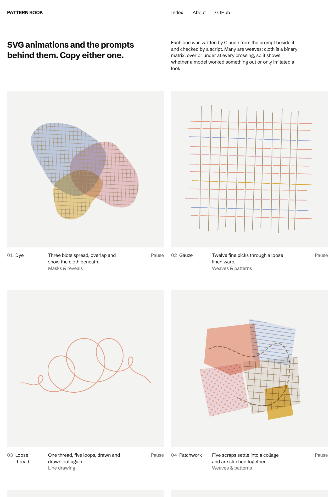

# Pattern Book

An open library of SVG animations and the prompts behind them. Each animation was written by a language model (Claude) from the prompt beside it, then checked by a script and reviewed. Take the animation, or take the prompt and make your own.



Every entry is a folder:

```
entries/gauze/
  animation.svg   the result
  prompt.md       the prompt behind it
  meta.json       technique, model, how many turns it took, what the prompt taught
```

## Why weaving

A weave is a binary matrix: at every crossing a thread is over or under. That makes cloth a good test of whether a language model is working something out or only imitating a look. The weave entries put the draft in the prompt and ask for it to be drawn honestly.

## Run it

```
npm install
npm run dev
```

`npm run check` validates every entry against [SPEC.md](SPEC.md). `npm run build` runs the check, then writes a static site to `out/`.

## How the site shows SVG

Entries are loaded with ``, never inlined. The browser runs no scripts from an image, and ids and styles inside one file cannot collide with another. Tiles play as soon as the page opens. Pause swaps in a static poster (the same file with animation off), and a `prefers-reduced-motion` rule inside each SVG shows that resting frame to people who ask for less motion.

## How entries are made

The repository is set up for working with a coding agent. `CLAUDE.md` holds the project rules, `.claude/skills/svg-motion` describes how an entry is produced, and `.claude/agents` defines five reviewers: two look at every animation (motion craft, prompt and provenance) and three look at the site as a whole. They work from evidence, a 12-frame strip rendered by `scripts/frames.cjs`, and a pass or fail rubric. A person makes the final call.

## Add an entry

1. Create `entries/<slug>/` with the three files above.
2. Run `npm run check`.
3. Open a pull request. Say honestly how the file was made; `SPEC.md` explains the three provenance labels.

## Licence

Code: MIT. Animations and prompts: CC BY 4.0. Schibsted Grotesk: SIL Open Font License.
